<h1 align="center">Local Kubernetes on macOS with <code>kiac</code>, declared in Pkl</h1>

<p align="center">
  <a href="https://github.com/extropy-eng/formae-plugin-kiac/actions/workflows/ci.yaml">
    </a>
  <a href="https://github.com/saiyam1814/kiac/releases">
    </a>
  <a href="https://github.com/platform-engineering-labs/formae/releases">
    </a>
  <a href="https://github.com/extropy-eng/formae-plugin-kiac/blob/trunk/LICENSE">
    </a>
</p>

This is the [formae](https://formae.io) plugin for [kiac](https://github.com/saiyam1814/kiac).
It lets you create and manage local Kubernetes clusters from a `.pkl` file, with the same
plan and apply workflow you use for cloud infrastructure.

`kiac` runs every Kubernetes node as its own lightweight VM on Apple silicon. `formae` turns
those clusters into source-controlled infrastructure.

```pkl
new kiac.Cluster {
  label = "dev-cluster"
  name = "dev"
  distro = "k3s"
  workers = 2
}
```

`formae apply --mode reconcile main.pkl` gives you a real multi-node cluster, ready for
`kubectl`.

## Why use kiac and formae together

Local Kubernetes usually means one hidden Linux VM running several "nodes" as containers
that share a kernel. kiac gives each node its own VM through Apple's `container` runtime.
Stopping a node behaves like a real machine going offline, and `kubectl top`, LoadBalancer
services, and storage work without extra wiring.

`formae` is an infrastructure-as-code tool. You describe the state you want in Pkl, and
formae works out what to create, change, or delete. This plugin teaches formae how to
drive kiac.

The combination gives you:

- Repeatable clusters. The cluster definition lives in Git, not in a shell history.
- Real node isolation for testing scheduling, eviction, and node failure.
- One lifecycle. Create, inspect, stop, resume, and destroy clusters with `formae`.
- A local workflow that matches production. The same Pkl, plan, and apply model works
  with cloud providers.
- No Docker Desktop, Lima, or QEMU requirement. kiac uses Apple's native container
  runtime.

## What you can manage

| Resource type | What it does |
| --- | --- |
| `KIAC::Cluster::Cluster` | A kiac cluster of lightweight VM nodes. Create is asynchronous. |
| `KIAC::Cluster::Node` | A node VM in a cluster. Only power state is mutable. |
| `KIAC::Cluster::Image` | An image loaded into every node of a cluster. |
| `KIAC::Cluster::Verification` | A read-only health snapshot from `kiac verify cluster`. |
| `KIAC::Cluster::Resume` | Heals a cluster after a host reboot. Change `nonce` to run it again. |
| `KIAC::GPU::Compat` | Opt-in NVIDIA resource-name compatibility for one namespace. |

## System requirements and prerequisites

You need an Apple silicon Mac. kiac does not support Intel Macs.

| Requirement | Version / Notes |
| --- | --- |
| macOS | `apple/container` requires macOS 26 or later. kiac documents limited single-node use on macOS 15, but multi-node clusters need macOS 26. |
| Hardware | Apple silicon (M1 or later). At least 16 GiB RAM recommended. |
| Disk | 20 GB free recommended. Each node also uses disk for its VM image and data. |
| [formae](https://docs.formae.ai/documentation/get-started/quickstart) | `0.90.5` or later. This plugin's manifest declares that minimum. |
| [apple/container](https://github.com/apple/container#get-started) | `1.7.1` or later. After installing the signed package, run `container system start`. |
| [kiac](https://saiyam1814.github.io/kiac/docs/index.html) | `0.11.0` or later. |
| `kubectl` | Any version compatible with your cluster. |
| Container runtime | Running before you apply. Use `container system start` and verify with `kiac doctor`. |

No cloud account, credentials, or secrets are needed. The plugin manages one local target
per host.

Optional GPU workers need additional tooling.

See the [kiac GPU requirements](https://github.com/saiyam1814/kiac#run-a-real-apple-gpu-workload-beta).

## Quick start

### 1. Install the `formae` CLI

```bash
/bin/bash -c "$(curl -fsSL https://hub.platform.engineering/get/formae.sh)"
export PATH=/opt/pel/bin:$PATH
formae --version
```

Add the `PATH` line to your shell profile so future terminals find formae.

### 2. Install `apple/container`

Install the signed `container` package from the `apple/container`
[releases page](https://github.com/apple/container/releases):

#### mise

```bash
mise use container
```

#### Homebrew

```bash
brew install container
```

Then start it up:

```bash
container system start
```

### 3. Install kiac`

Install `kiac` then check the host with `kiac doctor`:

#### mise

```bash
mise use github:saiyam1814/kiac
```

#### Homebrew

```bash
brew install --cask saiyam1814/tap/kiac
```

Fix anything `kiac doctor` reports before continuing.

### 4. Install the plugin from the Formae Hub

```bash
formae plugin install kiac
formae plugin list
```

The plugin store is root-owned on a stock install, so the command may ask for `sudo`.

See the [Consume the plugin through the Formae Hub](#consume-the-plugin-through-the-formae-hub) section
below for instructions on how to search, update, and pin a version of this plugin.

### 5. Start the `formae` agent

Run the agent in its own terminal and leave it running:

```bash
formae agent start
```

It discovers installed plugins at startup. Restart it after installing, updating, or removing
a plugin.

### 6. Create a project

In a second terminal:

```bash
mkdir -p kiac-demo
cd kiac-demo
formae project init --include kiac
```

This writes a `PklProject` that resolves the formae and kiac schemas, plus a starter
`main.pkl`.

### 7. Describe a cluster

Replace the starter `main.pkl` with:

```pkl
amends "@formae/forma.pkl"

import "@formae/formae.pkl"
import "@kiac/core/kiac.pkl"

forma {
  new formae.Stack {
    label = "kiac-demo"
    description = "A local kiac cluster"
  }

  new formae.Target {
    label = "local"
    namespace = "KIAC"
    config = new kiac.Config {}
  }

  new kiac.Cluster {
    label = "dev-cluster"
    name = "dev"
    distro = "k3s"
    workers = 2
  }
}
```

The full example is in [`examples/basic/main.pkl`](examples/basic/main.pkl).

### 8. Apply and connect

```bash
formae apply --mode reconcile main.pkl
kubectl config use-context kiac-dev
kubectl get nodes -o wide
```

Cluster creation returns while the VMs are still booting. formae polls status until every
node is running. The first apply pulls images and can take a few minutes.

Useful checks:

```bash
kiac get clusters
kiac get nodes --name dev
kiac verify cluster --name dev
```

### 9. Clean up

```bash
formae destroy main.pkl
```

This deletes the cluster and its node VMs.

## Consume the plugin through the Formae Hub

The plugin is distributed through the public Formae Hub under the name `kiac`.
You do not need to clone this repository or build the binary to use it.

Search for it and inspect the available versions:

```bash
formae plugin search kiac
formae plugin info kiac
```

Install the latest version, or pin one:

```bash
formae plugin install kiac
formae plugin install kiac@0.1.0
```

Restart the agent after any plugin change. If it is already running, stop it first:

```bash
formae agent stop
formae agent start
```

Keep the plugin current:

```bash
formae plugin update kiac
```

Remove it from the host:

```bash
formae plugin uninstall kiac
```

### Add the schema to an existing project

`formae project init --include kiac` handles this for a new project. For an existing
project, add the kiac schema to `PklProject` and resolve dependencies:

```pkl
dependencies {
  ["kiac"] {
    uri = "package://hub.platform.engineering/plugins/kiac/schema/pkl/kiac/kiac@<version>"
  }
}
```

```bash
pkl project resolve
```

Use the version shown by `formae plugin info kiac` or on the Hub page.
The schema package name is `kiac`, so the import stays `@kiac/core/kiac.pkl`
whichever version you pin.

If your Hub mirror does not list the plugin yet, use the local install path in
[Develop the plugin](docs/DEVELOPMENT.md#install-locally-and-use-it-from-a-project).

## Configuration

A target tells formae where to run the plugin. kiac is local only, so one target per host
is enough. There are no credentials.

```pkl
new formae.Target {
  label = "local"
  namespace = "KIAC"
  config = new kiac.Config {
    kiacPath = "kiac"
    containerPath = "container"
    defaultWaitSeconds = 300
    statusTimeoutSeconds = 10
  }
}
```

| Field | Default | Meaning |
| --- | --- | --- |
| `kiacPath` | `kiac` | Path to the kiac binary. |
| `containerPath` | `container` | Path to the Apple container binary. Reserved for future runtime checks. The plugin does not call it today. |
| `defaultWaitSeconds` | `300` | How long an asynchronous create may run before status reports a timeout. |
| `statusTimeoutSeconds` | `10` | Deadline for one status probe. A slow probe reports progress instead of blocking the agent. |

## How it works

```mermaid
%%{
  init: {
    "theme": "base",
    "themeVariables": {
      "fontSize": "16px",
      "primaryColor": "#eef2ff",
      "primaryTextColor": "#1e1b4b",
      "primaryBorderColor": "#4f46e5",
      "lineColor": "#818cf8",
      "edgeLabelBackground": "#f8fafc",
      "clusterBkg": "#f8fafc",
      "clusterBorder": "#94a3b8"
    },
    "themeCSS": ".edgePath path{stroke:#818cf8!important}marker path{fill:#818cf8!important}"
  }
}%%
flowchart LR
    P["main.pkl<br/>desired state in Pkl"]

    subgraph FORMAE["formae"]
        A["CLI + agent"]
    end

    subgraph PLUGIN["kiac plugin process"]
        direction TB
        S["Go SDK boundary"]
        L["Lisette resource logic"]
        E["os/exec"]
        S --> L --> E
    end

    subgraph MAC["macOS runtime"]
        K["kiac CLI"]
        C["apple/container"]
        V["node VMs"]
        K --> C --> V
    end

    P --> A --> S
    E --> K
    L -. "resource lifecycle<br/>status polling" .-> A

    classDef source fill:#f8fafc,stroke:#334155,stroke-width:2px,color:#0f172a
    classDef inbound fill:#eef2ff,stroke:#4f46e5,stroke-width:2px,color:#1e1b4b
    classDef core fill:#f0fdf4,stroke:#16a34a,stroke-width:2px,color:#14532d
    classDef outbound fill:#ecfeff,stroke:#0891b2,stroke-width:2px,color:#164e63
    classDef runtime fill:#fff7ed,stroke:#ea580c,stroke-width:2px,color:#7c2d12
    class P source
    class A,S inbound
    class L core
    class E,K,C outbound
    class V runtime
```



The plugin implements the formae plugin SDK. It does not reimplement kiac.
Every resource operation becomes a `kiac` command, and the plugin reads kiac's JSON
output to report resource properties and status.

The resource logic is written in [Lisette](https://lisette.run), a language that
transpiles to Go. The formae SDK and the `os/exec` boundary stay as Go interop.
See [docs/DESIGN.md](docs/DESIGN.md) for the architecture and the language trade-offs.

## Troubleshooting

Run `kiac doctor` first. It checks the container runtime and the kiac installation,
and `kiac doctor --fix` can start the container service.

If the agent does not see the plugin, check `formae plugin list` and restart `formae agent`.

If a cluster create reports `Plugin operator is missing in action`, read
[the incident record](docs/bugs/2026-11-03-plugin-operator-missing-in-action.md).
It explains the status watchdog, the fix, and the remaining risk on non-status lookup
paths.

## Learn more

- [Technical Design](docs/DESIGN.md)
- [Basic Example](examples/basic/main.pkl)
- [Formae Documentation](https://docs.formae.ai)
- [kiac Documentation](https://saiyam1814.github.io/kiac/)

## Contributing

See [DEVELOPMENT](docs/DEVELOPMENT.md).

## License

[MIT](LICENSE)

## Attributions

Built and tested on macOS 27.2 by [Extropy Engineering](https://github.com/extropy-eng).

Assisted by *DeepSeek v4.1 Flash* using [OpenCode v2](https://github.com/anomalyco/opencode)
with [Superpowers](https://github.com/obra/superpowers).
