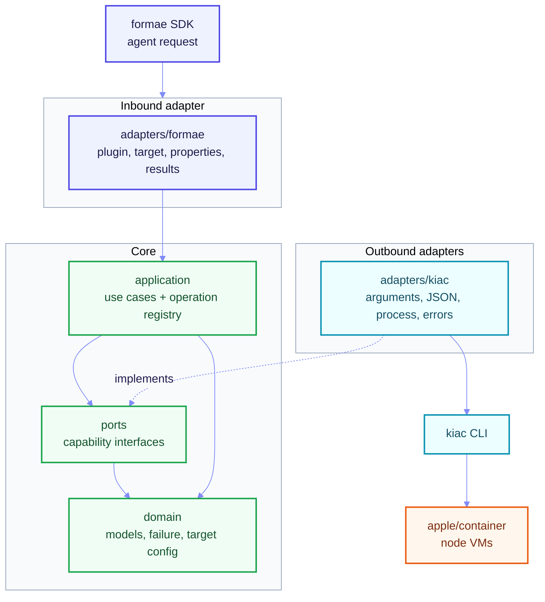
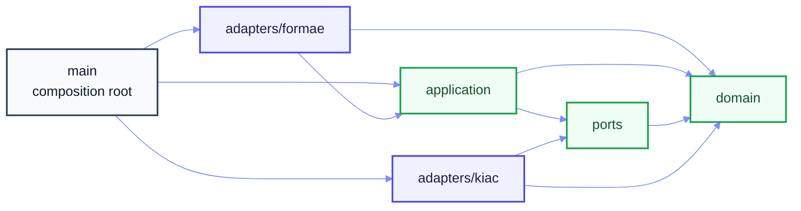
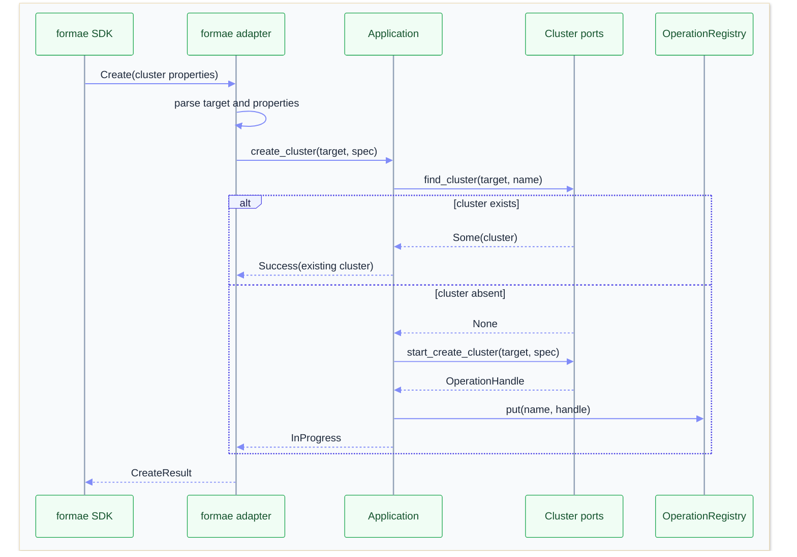
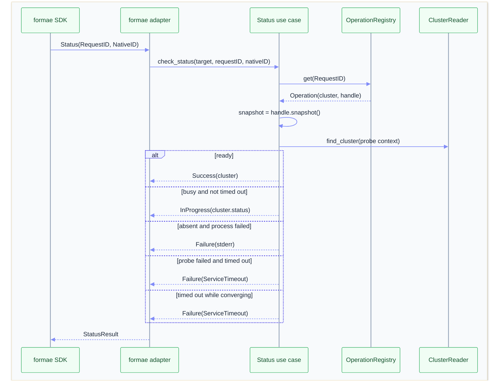

# Technical Design

This document records the design of the kiac formae plugin. It covers the
runtime architecture, the resource model, asynchronous operations, failure
handling, testing, language choices, and the build toolchain.

## Intent

The plugin makes local Kubernetes on macOS manageable as infrastructure as
code. A user describes a kiac cluster and its supporting resources in Pkl.
formae plans and applies the change through the plugin. The plugin drives the
installed `kiac` CLI, which in turn drives Apple's `container` runtime.

The plugin delegates cluster behaviour to kiac:

- It uses kiac's cluster and node semantics.
- It reports resource properties that kiac can observe.
- It keeps create, read, update, delete, list, and status predictable.
- It runs on macOS with Apple silicon, where kiac and `apple/container` are
  supported.

## Goals and non-goals

### Goals

- Enforce one direction of dependency: adapters depend on the core, never the
  reverse.
- Keep the domain and application layers free of formae SDK types, `os/exec`,
  and wire-format JSON tags.
- Make resource decisions testable without starting processes.
- Keep the kiac CLI adapter testable with a fake `kiac` shell executable.
- Preserve kiac's observable behaviour.

### Non-goals

- Adding resources, commands, or configuration fields that kiac does not
  support.
- Using `containerPath`. The target stores it, but the plugin does not invoke
  it.
- Applying bounded status timeouts to non-status lookups.

## Architecture

The plugin is one process managed by the formae agent. It implements the formae
`ResourcePlugin` interface and receives target configuration, resource
properties, and operation requests.

The plugin shells out to `kiac` for every infrastructure operation. It does not
talk to the container runtime API directly. This keeps kiac as the single owner
of cluster behaviour, including image selection, VM boot, networking, addons,
and kubeconfig management.

The Pkl schema is part of the user interface. It defines property names,
defaults, create-only fields, write-only fields, parent-child relationships,
and discovery behaviour. The plugin binary and the schema are installed
together.

### Hexagonal Architecture: Ports & Adapters



The inbound adapter translates formae requests into application calls. The
application makes resource decisions through ports. The outbound adapter turns
port calls into CLI commands and turns CLI output back into domain values.
`main.lis` is the only package that knows every concrete type.

### Dependency rules



The arrows are import directions. There is no arrow from core back to an
adapter. `domain` has no project imports. `ports` imports `domain`.
`application` imports `domain` and `ports`. Adapters import the core; the core
never imports an adapter.

### Package map

```text
src/
  main.lis
  domain/
  ports/
  application/
  adapters/
    formae/
    kiac/
```

Lisette packages are directories. A file in `src/domain` is in the `domain`
package and is imported as `import "domain"`. The root package contains
`main.lis` and is the only place that wires concrete adapters together. Tests
are colocated with the package they exercise.

## Domain

The domain package contains values and policies that do not depend on formae,
the CLI, or JSON:

- `TargetConfig`: local runtime configuration after defaults are applied.
- `Cluster`, `Node`, and `ClusterSpec`: observed clusters and requested cluster
  shape.
- `MountSpec`, `PortMappingSpec`, and `NodeSpec`: request building blocks.
- `NodePower`: the closed set of node power states.
- `GpuCompat`, `GpuCompatState`, `Image`, `Verification`, and `Resume`.
- `ProcessSnapshot`: the background-process state the status use case reads.
- `Failure` and `ErrorKind`: the plugin's error vocabulary.

The domain deliberately has no `#[json]` attributes. Wire DTOs belong to
adapters. This keeps kiac's JSON field names and formae's property names out of
resource decisions.

`NodePower` is the closed set of node power states:

```rust
pub enum NodePower {
  Running,
  Stopped,
}

pub fn node_power_for(state: string) -> Option<NodePower> {
  match state {
    "running" => Some(NodePower.Running),
    "stopped" => Some(NodePower.Stopped),
    _ => None,
  }
}
```

The CLI verb (`start` or `stop`) stays in the kiac adapter because it is a CLI
detail, not a domain concept.

### Failure vocabulary

```rust
pub enum ErrorKind {
  InvalidRequest,
  NotFound,
  DependencyFailure,
  AlreadyExists,
  ServiceTimeout,
  AccessDenied,
  GeneralServiceException,
  NotUpdatable,
  InternalFailure,
}

pub struct Failure {
  pub kind: ErrorKind,
  pub message: string,
}

impl Failure {
  pub fn Error(self) -> string {
    self.message
  }
}
```

`ErrorKind` is mapped to `resource.OperationErrorCode` in exactly one place:
`adapters/formae/results.lis`. The kiac adapter classifies `stderr` into
`ErrorKind`; it does not import the formae SDK.

## Ports

The outbound ports are segregated by capability. Each application use case
depends only on the methods it calls. `KiacCli` structurally implements all of
them, so no composite `Kiac` interface is required.

```rust
pub interface ClusterReader {
  fn list_clusters(ctx: context.Context, target: domain.TargetConfig)
    -> Result<Slice<domain.Cluster>, domain.Failure>
  fn find_cluster(ctx: context.Context, target: domain.TargetConfig, name: string)
    -> Result<Option<domain.Cluster>, domain.Failure>
}

pub interface ClusterLifecycle {
  fn start_create_cluster(target: domain.TargetConfig, spec: domain.ClusterSpec)
    -> OperationHandle
  fn start_resume_cluster(target: domain.TargetConfig, cluster: string)
    -> OperationHandle
  fn delete_cluster(ctx: context.Context, target: domain.TargetConfig, name: string)
    -> Result<(), domain.Failure>
}

pub interface NodePowerController {
  fn set_node_power(
    ctx: context.Context,
    target: domain.TargetConfig,
    cluster: string,
    node: string,
    power: domain.NodePower,
  ) -> Result<(), domain.Failure>
}

pub interface ImageLoader {
  fn load_image(
    ctx: context.Context,
    target: domain.TargetConfig,
    cluster: string,
    image: string,
  ) -> Result<(), domain.Failure>
}

pub interface GpuCompatController {
  fn set_gpu_compat(
    ctx: context.Context,
    target: domain.TargetConfig,
    cluster: string,
    namespace: string,
    enabled: bool,
    rotate: bool,
  ) -> Result<(), domain.Failure>
}

pub interface ClusterVerifier {
  fn verify_cluster(ctx: context.Context, target: domain.TargetConfig, cluster: string)
    -> Result<domain.Verification, domain.Failure>
}

pub interface OperationHandle {
  fn snapshot() -> domain.ProcessSnapshot
}
```

Two boundaries are intentionally not ports:

- `OperationRegistry` is in-memory application state. It is not an external
  system, so it lives in the core.
- Time is a Go standard-library concern. Status compares `time.Since` with the
  snapshot's start time. Tests use a fake handle with an old timestamp instead
  of a clock port.

`probe_cluster` is also not a port. The status use case owns the
`statusTimeoutSeconds` deadline and applies it to `find_cluster`.

## Application

`Application` holds the small outbound ports plus one `OperationRegistry`:

```rust
pub struct Application {
  reader: ports.ClusterReader,
  lifecycle: ports.ClusterLifecycle,
  node_power: ports.NodePowerController,
  image_loader: ports.ImageLoader,
  gpu_compat: ports.GpuCompatController,
  verifier: ports.ClusterVerifier,
  ops: mut OperationRegistry,
}
```

Use cases are methods on `Application`, grouped by resource:

- cluster: create, read, delete, list.
- node: create, read, update, delete, list.
- operations: GPU compatibility, image, verification, resume.
- status: cluster and resume status polling.

The application returns domain outcomes, not SDK result structs:

```rust
pub enum ResourceProperties {
  None,
  Cluster(domain.Cluster),
  Node { cluster: string, node: domain.Node },
  GpuCompat(domain.GpuCompat),
  GpuCompatState(domain.GpuCompatState),
  Image(domain.Image),
  Verification(domain.Verification),
  Resume(domain.Resume),
}

pub struct CreateOutcome {
  pub native_id: string,
  pub request_id: string,
  pub status: CreateStatus,
  pub message: string,
  pub properties: ResourceProperties,
}
```

`CreateStatus` is `Success` or `InProgress`. `UpdateOutcome` and `DeleteOutcome`
carry the same kind of domain data. `StatusOutcome` is an enum with
`InProgress`, `Success`, and `Failure` variants. The formae adapter encodes
these values into `resource.ProgressResult` and JSON.

## Adapters

### Inbound formae adapter

`adapters/formae` is the only package that imports the formae SDK:

- `plugin.lis`: implements the `ResourcePlugin` methods, dispatches by resource
  type, and owns the SDK result boundary.
- `target.lis`: parses raw target JSON into `domain.TargetConfig` and applies
  defaults.
- `properties.lis`: decodes request properties into domain specs and encodes
  domain values into read-property JSON.
- `results.lis`: maps `ErrorKind` to `resource.OperationErrorCode`, builds
  progress results, and provides the raw-message helper.

The dispatch rules are:

- `Create` supports all six resource types.
- `Read` supports all six resource types.
- `Update` supports only node and GPU compatibility. Every other type returns
  `NotUpdatable`.
- `Delete` supports all six resource types.
- `List` supports only cluster and node. Every other type, and every lookup
  failure, returns an empty list.
- `Status` supports only cluster and resume. Every other type returns an
  `InvalidRequest` failure result.

Target parsing is applied where a path needs the CLI. Read-only projections and
no-op deletes do not require it. The adapter follows the path each resource
needs rather than normalizing every branch.

### Outbound kiac adapter

`adapters/kiac` owns every external detail:

- `args.lis`: pure arguments construction from domain specs.
- `dto.lis`: kiac JSON DTOs and mapping into domain values.
- `errors.lis`: `stderr` classification into `ErrorKind`.
- `runner.lis`: synchronous `exec.CommandContext` calls with `WaitDelay`.
- `process.lis`: background process handles and snapshots.
- `cli.lis`: `KiacCli`, which implements the capability ports.

The adapter never sees formae request or result types. It receives
`TargetConfig`, domain specs, and returns domain values or `Failure`.

### Composition root

`main.lis` constructs one `KiacCli`, passes it to `application.new` once for
each small port, wraps the application in the formae plugin, and calls
`sdk.RunWithManifest`:

```rust
let cli = kiac.KiacCli { .. }
let mut app = application.new(cli, cli, cli, cli, cli, cli)
let mut plugin = formae.Plugin.new(app)
sdk.RunWithManifest(&plugin, sdk.RunConfig { .. })
```

Passing the same concrete adapter to several small ports is intentional. The
adapter satisfies each capability structurally, while each use case only knows
the methods it needs.

## Behaviour

### Resource model

| Resource | Native ID | Behaviour |
| --- | --- | --- |
| `KIAC::Cluster::Cluster` | Cluster name | Async create, read, list, delete, status. |
| `KIAC::Cluster::Node` | `<cluster>/<node>` | Read, list, update power, no-op delete. |
| `KIAC::GPU::Compat` | `<cluster>/<namespace>` | Enable or disable NVIDIA compatibility. |
| `KIAC::Cluster::Image` | `<cluster>/<image>` | Load an image into every node. |
| `KIAC::Cluster::Verification` | Cluster name | Read-only health snapshot. |
| `KIAC::Cluster::Resume` | `<cluster>/<nonce>` | Async heal after a host reboot. |

Cluster creation accepts a name, distro, CNI, worker count, optional GPU
workers and image, gateway and no-lb toggles, DNS entries, mounts, and
published ports. kiac reports only observed cluster state: status, node counts,
installed Kubernetes version, creation time, and nodes.

The schema marks properties `createOnly` when kiac cannot change them after
creation and `writeOnly` when kiac cannot read them back. Returning a made-up
value for a write-only property would make formae believe it can detect drift
that kiac cannot report.

`Node` declares a parent reference to `Cluster` through `clusterName`, so the
agent can order node operations after the cluster exists. `Image`,
`Verification`, `Resume`, and `GPU::Compat` are not discoverable because kiac
cannot enumerate them independently.

### CLI mapping

| Operation | kiac command |
| --- | --- |
| List clusters | `get clusters -o json` |
| Create cluster | `create cluster --name ...` plus optional flags |
| Delete cluster | `delete cluster --name ...` |
| Start node | `start node <node> --name <cluster>` |
| Stop node | `stop node <node> --name <cluster>` |
| Load image | `load image <image> --name <cluster>` |
| GPU compat | `gpu compat enable` or `gpu compat disable` |
| Verify cluster | `verify cluster --name ... -o json` |
| Resume cluster | `resume cluster --name ...` |

Cluster arguments construction keeps kiac's rules:

- `--cni` is omitted for `k3s`.
- Worker and GPU counts are emitted only when positive.
- `--gpu-image` is emitted when an image is set.
- `--dns` is emitted once per entry, including empty entries.
- Mount specs use `type=...,source=...,target=...[,readonly]`.
- Publish specs use `[hostIp:]hostPort:containerPort[/protocol]`.

### Async and status

Cluster create and resume start a background `kiac` process. The application
stores an `OperationHandle` in a mutex-guarded registry keyed by cluster name.
Status reads the handle snapshot, probes the cluster with a bounded context,
and decides:

1. If the cluster exists and its running node count equals its total node
   count, success.
2. If the cluster exists but is not ready and the convergence deadline has not
   passed, in progress with the cluster status.
3. If the cluster exists and the deadline has passed, service timeout.
4. If the cluster is absent and the process failed, general service exception
   with the captured error string.
5. If the probe failed and the deadline has not passed, in progress with the
   probe error message.
6. If the probe failed and the deadline has passed, service timeout.

The plugin prefers observed cluster state over the process exit code. A
background process may exit while the cluster is still converging.

#### Bounded status probes

`kiac get clusters` shells out to the container runtime. During VM boot it can
stall. An unbounded probe can outlive the agent's watchdog and make the plugin
look missing in action even though the cluster is being created.

`Status` therefore probes through a context with `statusTimeoutSeconds`
(default: 10 seconds). If the probe times out or fails, status stays in
progress with the probe message while the convergence deadline has not passed.
Once `defaultWaitSeconds` is exceeded, status returns `ServiceTimeout`.

The synchronous subprocess runner also sets `cmd.WaitDelay` when the context has
a deadline. Killing `kiac` is not enough if a child process still holds the
output pipes; `WaitDelay` bounds that final drain.

### Idempotency

The plugin assumes the agent may retry any operation:

- Creating a cluster that already exists returns success with observed
  properties.
- Deleting a cluster that does not exist returns success.
- Deleting a node, image, verification, or resume resource is a no-op.
- Updating a node to its current power state is a no-op.
- Resuming a cluster is safe to repeat. The `nonce` property requests a new
  run.

These choices keep a failed or interrupted apply recoverable without manual
cleanup.

### Failure mapping

| Source | `ErrorKind` |
| --- | --- |
| Invalid target or properties | `InvalidRequest` |
| Missing cluster or node | `NotFound` |
| Missing parent cluster | `DependencyFailure` |
| `already exist` in stderr | `AlreadyExists` |
| `not found` or `no such` in stderr | `NotFound` |
| `timed out` or `timeout` in stderr | `ServiceTimeout` |
| `permission` or `denied` in stderr | `AccessDenied` |
| Any other subprocess failure | `GeneralServiceException` |
| Unsupported update | `NotUpdatable` |
| Invalid verify output | `InternalFailure` |

The formae adapter maps these to the corresponding
`resource.OperationErrorCode` values. Read failures carry only the code, as the
SDK expects.

## Configuration

The target configuration is local and does not require credentials:

```pkl
new kiac.Config {
  kiacPath = "kiac"
  containerPath = "container"
  defaultWaitSeconds = 300
  statusTimeoutSeconds = 10
}
```

| Field | Default | Meaning |
| --- | --- | --- |
| `kiacPath` | `kiac` | Path to the kiac binary. |
| `containerPath` | `container` | Apple container binary. Reserved for future runtime checks. |
| `defaultWaitSeconds` | `300` | Convergence deadline for asynchronous creates. |
| `statusTimeoutSeconds` | `10` | Deadline for one status probe. |

Defaults are applied if the target omits a field or supplies an invalid value.
Empty or non-positive wait values fall back to defaults instead of creating an
unbounded operation.

## Flows

<!-- markdownlint-disable MD013 -->

### Cluster create



### Status polling



<!-- markdownlint-enable MD013 -->

## Testing strategy

Tests are colocated with the package they exercise. The suite has 132 tests:

| Layer | Tests | Focus |
| --- | ---: | --- |
| Domain | 7 | ID and text helpers, node power policy, failure messages, model equality. |
| Ports | 2 | Structural port contracts. |
| Application | 44 | Cluster, node, status, registry, GPU compatibility, image, verification, and resume decisions. |
| Kiac adapter | 26 | Arguments construction, JSON parsing, stderr classification, process runner, async handles. |
| Formae adapter | 53 | Target parsing, property codecs, result mapping, resource dispatch, end-to-end paths. |

The kiac adapter tests use a fake `kiac` executable: a temporary shell script
that records arguments, emits JSON, writes to `stderr`, sleeps, or exits with a
chosen status. The application tests use fake ports and fake operation handles.
No unit test starts a real container runtime. The suite runs on Linux CI.

The Go conformance harness in `conformance_test.go` is guarded by the
`conformance` build tag. It runs CRUD and discovery tests against the installed
plugin binary on macOS, using a real formae agent and the real kiac runtime. It
is separate from the Lisette unit suite.

## Language choices

### Why Lisette for the resource logic

The formae SDK needs an `OperationErrorCode` on every failure. Lisette lets the
core carry one typed failure through every call:

```rust
pub struct Failure {
  pub kind: ErrorKind,
  pub message: string,
}
```

Every fallible step returns `Result<T, Failure>`. The `?` operator propagates
the failure without losing the kind. The inbound adapter converts it once into
a formae progress result. Raw `stderr` is classified in one place, the kiac
adapter, where that text is the only information available.

The same type model makes state explicit elsewhere:

- `Option<T>` replaces nil conventions where absence is expected.
- Enums and `match` make node power transitions and resource dispatch visible.
- `#[equality]` gives whole-value equality to models that contain slices.
- JSON DTOs live in adapters and map explicitly to domain values.
- Immutable collections and folds describe arguments construction as data.

The main cost is the number of lines of code. Lisette requires explicit mutable
references for SDK result structs, which Go writes as one composite literal.
A result helper is longer even when the behaviour is the same. The plugin accepts
that cost because failure and state handling are the parts most likely to break.

### Why not Go for the resource logic

A Go-only resource core would pass `error` values around and re-derive the
formae code at the boundary by inspecting message text. That classification is
easy to duplicate and easy to get wrong. Go's nil lookups and struct tags also
spread wire concerns into resource code.

Lisette makes the intent local: a failure carries its kind until the SDK
boundary, absence is an `Option`, and JSON attributes stay in adapters. The
generated Go still handles the runtime and the SDK calls.

### Why not GALA

GALA is a compact language that transpiles to Go and can call the same SDK. It
is a reasonable choice for small programs. The plugin's hard parts are async
state, failure classification, and resource dispatch; Lisette's explicit types
make those visible, while GALA relies more on terseness and convention.

At the time of selection, GALA produces a binary that is twice the size of
the binary each produced by Go and Lisette. Lisette also provides a much richer
developer experience compared to GALA:

- it integrates painlessly with [popular editors and IDEs](https://lisette.run/docs/intro/quickstart/)
- it ships with [LSP support](https://lisette.run/docs/lsp/) through the `lis lsp` command
- its repo includes a [tree-sitter](https://github.com/ivov/lisette/tree/main/editors/tree-sitter-lisette)
  that can be integrated with TUI file managers like Yazi for browsing Lisette
  code
- it produces [richer test reports](https://lisette.run/docs/tests/)

### Why Go at the SDK boundary

The formae SDK is a Go library. Rewriting the protocol host would add risk
without changing user-visible behaviour. The boundary is intentionally small:

- `src/main.lis` calls `sdk.RunWithManifest`.
- `src/adapters/formae/plugin.lis` implements `ResourcePlugin` methods and
  converts internal failures into `ProgressResult` values.
- `src/adapters/kiac/runner.lis` and `process.lis` use `os/exec` to run `kiac`.
- Generated Go code is produced under `target/` by Lisette.

No resource behaviour lives in hand-written Go. If the SDK interface changes,
the adapters are the place to update.

## Build and toolchain

mise owns the development toolchain and task graph.

- Go is pinned to `1.26`. Lisette `0.13.0`'s `bindgen` knows the Go `1.26`
  standard library. Go `1.27` aliases `encoding/json.RawMessage` to
  `jsontext.Value`, which the binder cannot resolve.
- Lisette is installed through mise and transpiles `.lis` sources to Go under
  `target/`.
- Pkl validates the schema and the plugin manifest.
- `kiac` and `apple/container` are host prerequisites for development and
  conformance runs.

Tasks declare sources and outputs, so mise caches successful work. A repeat
`mise run test` skips the suite when no source or manifest file changed. A
repeat `mise run build` skips the transpile when its inputs and declared outputs
are unchanged.

`mise run check` runs the lint, unit tests, manifest validation, schema
validation, and dependency checks. `mise run install` depends on `check`, so a
failing check blocks installation.

The build writes the plugin version into `schema/pkl/VERSION` so the packaged
Pkl schema matches the manifest version. `formae-plugin.pkl` declares the
plugin name, namespace, version, license, category, and minimum formae version
(`0.90.5`). The release pipeline uses the same manifest to build the Hub
package.

## Trade-offs and known limits

- Lisette is a smaller ecosystem than Go. Fewer examples and fewer third-party
  libraries are available, though Go interop covers the SDK and standard
  library.
- The Go 1.26 pin is a toolchain constraint, not a product requirement.
- Only status uses the bounded probe. Other cluster and node lookups add no
  plugin-level deadline and rely on the agent's request context.
- `containerPath` is not used yet.
- The plugin preserves kiac behaviour and does not add features that kiac does
  not support.
- Conformance depends on a real macOS host with `apple/container` running.

## Future work

Apply the bounded probe to every cluster lookup, not only status. That removes
the remaining watchdog risk on create, read, delete, list, and node paths.

Other candidates:

- Add a fake runtime path for conformance tests so more of the lifecycle can
  run on Linux.
- Document generated Go inspection and debugging notes in
  [CONTRIBUTING](CONTRIBUTING.md).
